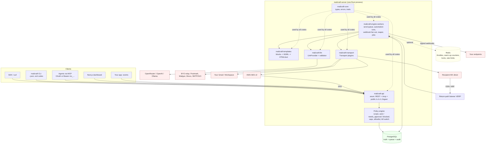

# mailcraft architecture

Companion to [SPEC.md](SPEC.md) (section numbers refer to it). Evidence: `mailer-research/{architecture,rust-stack,deliverability,agent-native,no-domain,journeys}.md`.

## 1. Shape

One Cargo workspace, one server binary (`mailcraft-server`: API + workers), one CLI (`mailcraft`), one Next.js dashboard. **Postgres is the source of truth and the job queue** (`FOR UPDATE SKIP LOCKED`). **Redis holds only volatile throttle/lock/counter state** and is never required for correctness [rust-stack §4]. No hosted relay exists; delivery is a plugin `Transport` (SPEC §9.1).

## 2. Component diagram



Crate responsibilities:

| Crate | Owns |
|---|---|
| `mailcraft-core` | domain types (`Stream`, `Policy`, `EmailStatus`), structured `Error`, retry schedule, traits `Transport` and `LlmProvider`. No I/O. |
| `mailcraft-api` | axum routes, auth, scope + policy middleware, idempotency, OpenAPI serving, MCP endpoint. Thin handlers calling core/engine functions (so the API layer stays replaceable) [rust-stack §3]. |
| `mailcraft-engine` | queue claim/lease/reaper, gates at dequeue, MIME build + DKIM, automation run advance, webhook fan-out, bounce/DSN processing, job runner. |
| `mailcraft-transport` | `smtp-relay`, `ses`, `gmail-oauth`, `direct`, later `kumomta`. |
| `mailcraft-llm` | providers (`openrouter` first), schema, validator, fallback. |
| `mailcraft-templates` | block tree -> MJML -> minijinja -> mrml -> HTML + text; import/export. |
| `mailcraft-cli` | clap commands, `--json`, exit codes, `doctor`, `mcp serve` (stdio). |

## 3. Request flows

### 3.1 Send (`POST /v1/emails`)

```mermaid
sequenceDiagram
  participant C as Client / agent
  participant A as API
  participant P as Policy
  participant DB as Postgres
  participant W as Worker
  participant T as Transport
  participant X as Relay / MX
  C->>A: POST /v1/emails (Bearer, Idempotency-Key)
  A->>DB: idempotency lookup (replay -> original response)
  A->>P: key scope, env (test/live), recipient allowlist, send caps, kill switch
  P-->>A: decision: auto | needs_approval | blocked
  alt dry_run
    A-->>C: rendered preview + lint + would_send_via (nothing stored)
  else blocked
    A-->>C: 403 blocked_by_policy + hint
  else needs_approval
    A->>DB: emails(status=pending_approval) + approvals row + audit
    A-->>C: 202 pending_approval + approval_id
  else auto
    A->>DB: tx: emails row(s) one per recipient, status=queued, audit
    A-->>C: 202 queued
  end
  W->>DB: claim due rows (FOR UPDATE SKIP LOCKED, lease)
  W->>W: gates at dequeue: kill switch, suppression, topic, caps, quiet hours, warm-up, throttle (Redis)
  W->>W: render (templates) -> MIME (List-Unsubscribe only if marketing) -> DKIM sign
  alt env = test
    W->>DB: store in sandbox inbox, simulate magic-address outcome
  else live
    W->>T: deliver(Outbound{VERP mail_from, rcpt, raw})
    T->>X: SMTP / API
    X-->>T: 2xx / 4xx / 5xx
    T-->>W: Accepted | Deferred | Rejected
  end
  W->>DB: tx: status + email_events (outbox) ; Deferred -> next_attempt_at = backoff
  W->>W: fan-out job -> signed webhooks (retry schedule)
```

Notes: gates run at **dequeue** so the kill switch stops already-queued mail [SPEC §14]; test keys never call a transport [SPEC §4.5]; a 5xx is a bounce and is never retried [deliverability §3.4].

### 3.2 Automation tick

```mermaid
sequenceDiagram
  participant App as Your app
  participant A as API
  participant DB as Postgres
  participant W as Worker
  App->>A: POST /v1/events {name, contact, properties} (Idempotency-Key)
  A->>DB: tx: upsert contact, insert track_events, enqueue matcher job
  W->>DB: matcher: active automations for event name + filter
  W->>DB: entry_rule check; insert automation_runs (unique entry_key) ; wake runs in wait_for_event
  loop runs with next_wake_at <= now (SKIP LOCKED)
    W->>W: goal/exit conditions? exit and cancel pending sends
    W->>W: execute steps until one waits or ends
    Note over W: delay -> next_wake_at ; wait_for_event -> state=waiting, timeout edge ; condition evaluated NOW ; update_contact / add_to_segment
    W->>W: send_email: gates (kill, suppression, topic, frequency cap, quiet hours, approval, caps)
    W->>DB: insert emails (key run_id:step:attempt) ; automation_run_steps
  end
```
Gate failures defer (`next_wake_at` moved) or skip with a recorded `policy_decision`; they never drop silently [SPEC §13].

### 3.3 Bounce / complaint processing

```mermaid
sequenceDiagram
  participant X as Recipient MX / ISP
  participant L as Return-path listener (VERP) / SES SNS
  participant W as Worker
  participant DB as Postgres
  X-->>W: sync 5xx at SMTP time (counts as a bounce, no DSN needed)
  X->>L: DSN to bounce+TOKEN@bounce.domain  or  ARF complaint  or  SNS event
  L->>W: raw message -> job
  W->>W: mail-parser/mail-auth: parse multipart/report (RFC 3464/3463) or ARF (RFC 5965)
  W->>W: match email via VERP token (not body)
  W->>W: classify: hard (5.1.x,5.2.1) | soft (4.x, 5.2.2, 5.4.x) | block (5.7.x, blocklist text)
  alt hard or complaint
    W->>DB: suppressions upsert + email_events(bounced|complained)
  else soft
    W->>DB: email_events(soft); suppress after 3-5 consecutive over >= 7 days
  else block / policy
    W->>DB: email_events(block); NO recipient suppression; alert, pause egress/domain, throttle
  end
  W->>DB: rolling bounce/complaint rates -> auto-pause stream if > 0.1% complaints / 2% bounces
  W->>W: webhook fan-out (email.bounced / email.complained / suppression.added)
```
One-click unsubscribes (`POST /u/{token}`) write the same suppression row (reason `unsubscribe`) but do not feed reputation alarms [deliverability §4.2].

### 3.4 LLM generation (inside a `send_email` step with `mode: llm`)

```mermaid
sequenceDiagram
  participant S as Automation step
  participant G as Generator (mailcraft-llm)
  participant M as LlmProvider (OpenRouter)
  participant V as Validator
  participant D as Spam scorer (rspamd/SA)
  participant DB as Postgres
  S->>G: contact + event + run -> context JSON (code-built; user text sanitized, capped)
  G->>DB: cache lookup (step, context hash)
  G->>M: system rules + template slots + context ; json_schema strict, require_parameters
  M-->>G: {subject, preheader, slots}
  G->>V: numbers/hosts in context? links via allowlist? tokens? banned terms? length? 
  V->>D: score final rendered MIME
  alt passed
    G->>DB: llm_generations(validator=pass)
    G-->>S: slots -> template doc -> render
  else failed (attempt 1)
    G->>M: retry once with issue list
  else failed twice or provider down
    G->>DB: llm_generations(used_fallback=true)
    G-->>S: static fallback copy
  end
  S->>DB: approval policy: first_n / always -> pending_approval with preview+lint ; else queue
```
The model never writes HTML or URLs; the template owns links, footer, unsubscribe and address [SPEC §10; deliverability §5.5].

## 4. Key design decisions

| Decision | Choice | Why |
|---|---|---|
| Language | Rust for engine + API (axum); no Go layer | One type system for queue rows, events and errors; one binary; fewer contributor barriers [rust-stack §3]. Reconsider only on a real need. |
| Queue | Postgres `SKIP LOCKED`, `emails` table is the queue | Transactional with business writes; throughput bounded by destination throttling long before PG limits [architecture §3.2]. |
| Redis | Throttles/warm-up counters/locks/rate limits only | Losing it costs accuracy for a minute, not mail [rust-stack §4]. Warm-up *stage* in Postgres. |
| MTA | Own core on Stalwart crates (`mail-send`, `mail-auth`, `mail-parser`, `mail-builder`) + hickory + rustls; Kumo later behind `Transport` | One state store; Kumo as scale-out sidecar [rust-stack §1]. |
| Default egress | Never the host's own IP; relay or Gmail first, direct after `doctor` | Port 25 blocking, PBL, no reputation [no-domain §1-2]. |
| Templates | JSON block tree canonical, MJML via mrml, minijinja variables | LLM- and editor-friendly, diffable, no Node [architecture §5.3]. |
| Contracts | `openapi.yaml` source of truth; MCP + CLI + SDK generated | Prevents drift [agent-native §2.6]. |
| Agent safety | Scopes, test/live, policy per key, approvals, caps, allowlist, hash-chained audit, kill switch at dequeue | [agent-native §3]. |
| Plugins | Compile-time crates behind Cargo features | Keeps single static binary. |

## 5. Deployment topology

`docker compose up -d` -> `postgres:17`, `redis:7`, `mailcraft` (`:8080`). Optional profiles: `caddy` (TLS for API and tracking hosts, on-demand certs for per-domain tracking CNAMEs), `dashboard`, `rspamd`. Egress needs: outbound 587/465 for relays; outbound 25 + PTR for direct. DNS records point CNAMEs/MX at the instance host so DKIM rotation needs no further user DNS work (SPEC §7.1).

## 6. Build order (maps to SPEC §17 and the work-package split in the handoff)

core + schema -> queue/worker + sandbox -> transports + domains/DKIM -> events/webhooks/bounces -> templates -> policy/approvals/audit -> automations -> LLM -> CLI/MCP/docs -> dashboard.
