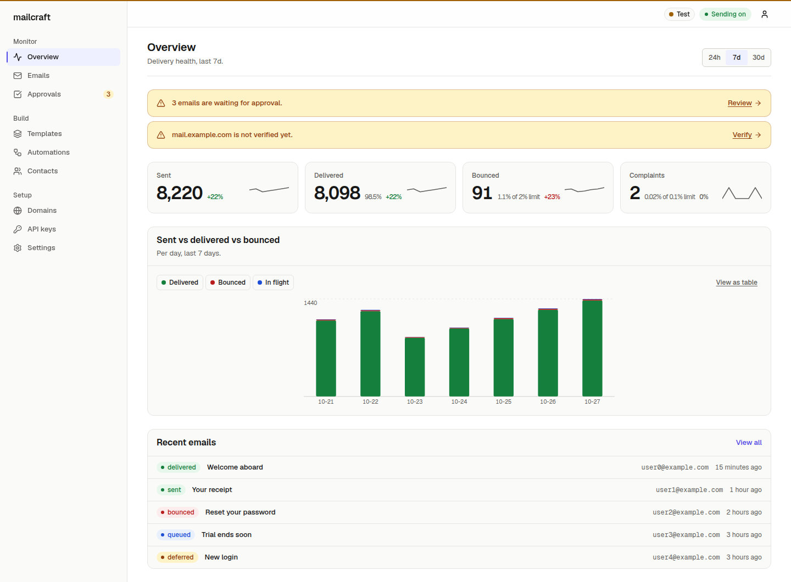
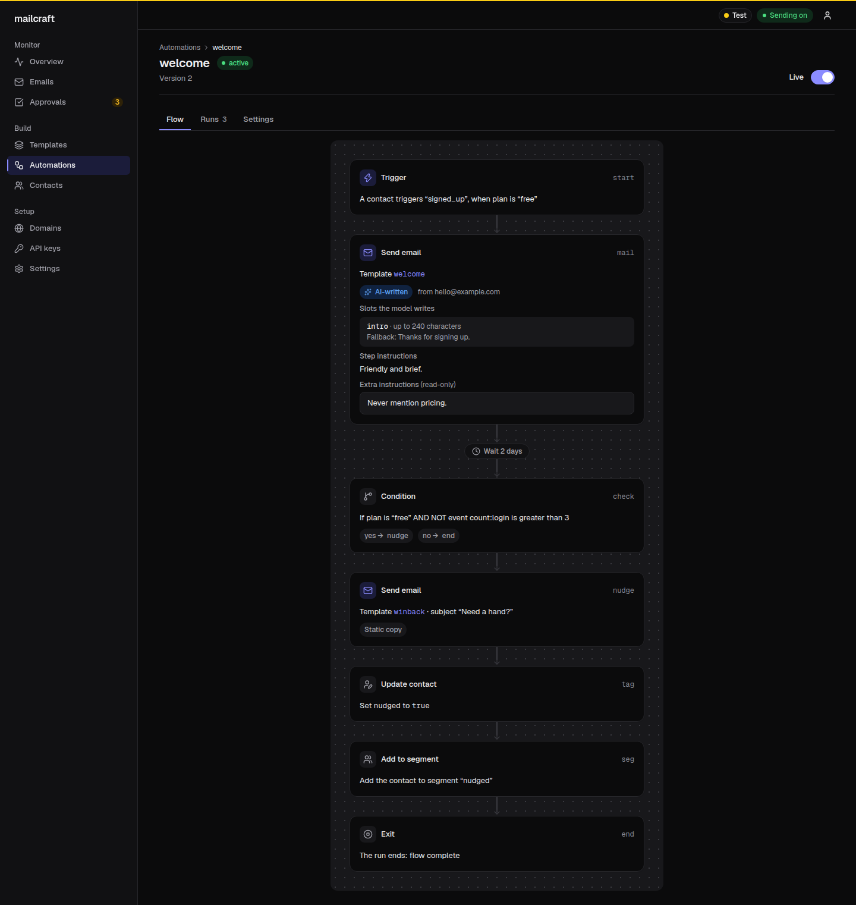
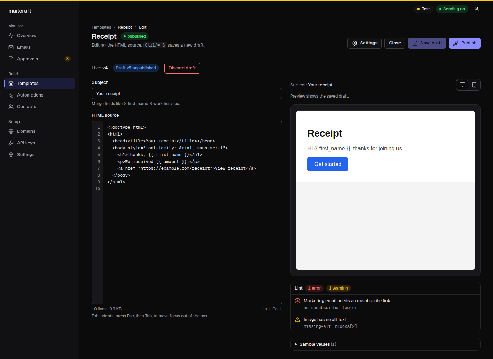
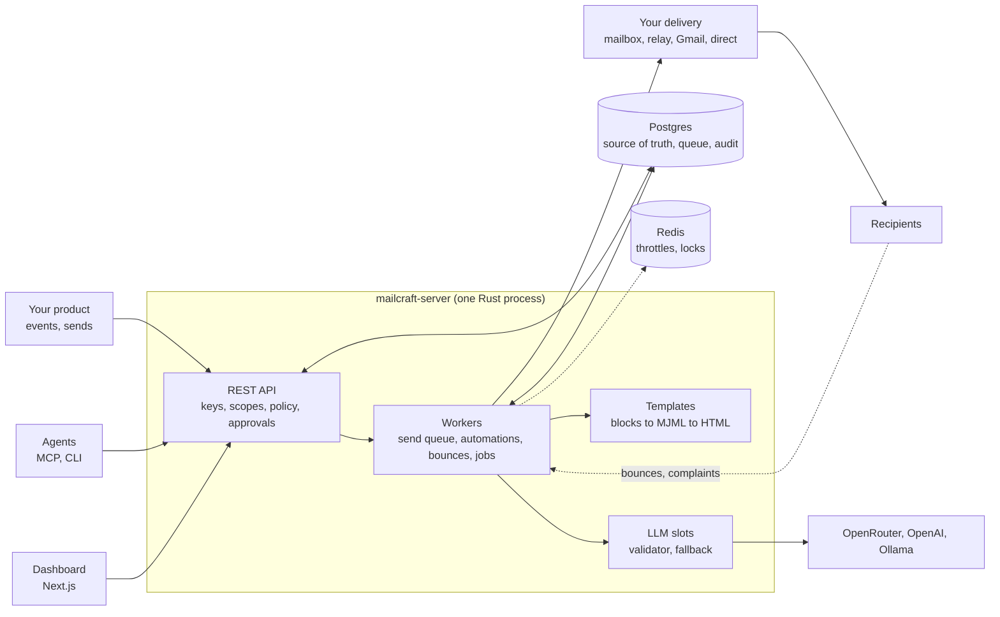

# mailcraft

**Open-source, self-hosted email for apps and AI agents.** Send transactional mail and broadcasts, and run event-triggered lifecycle
automations whose copy an LLM can write inside guardrails. AGPL-3.0, one Rust server, no per-email pricing.

[](LICENSE)
[](https://github.com/DibbayajyotiRoy/mailcraft/actions/workflows/ci.yml)
[](https://github.com/DibbayajyotiRoy/mailcraft/actions/workflows/quickstart.yml)
[](rust-toolchain.toml)
[](dashboard/)

<picture>
  <source media="(prefers-color-scheme: dark)" srcset="docs/images/overview-dark.png">
  
</picture>

Your product tells mailcraft what happened (`signed_up`, `first_success`, `credits.low`). An automation turns that into the right email,
at the right time, from a template you control. Where copy should adapt to the person, the model fills fixed slots from facts you
supplied, a validator checks every number, host and link, and static fallback text is sent when the check fails. Agents get an MCP
server, a JSON CLI and an approval queue, so they can set everything up without being able to send unchecked mail.

> **Status: pre-alpha.** Do not send production mail you cannot afford to lose with it yet. The API, send engine, automations,
> deliverability, dashboard, CLI, MCP server and TypeScript SDK are on `main`; a route or command that is not built answers
> `not_implemented`. [openapi.yaml](openapi.yaml) and `mailcraft --help` say what is real today.
> <!-- TODO(in-flight): add contact sources + lists, multiple senders, the in-dashboard assistant, the automation flowchart and SDK/MCP/CLI sync here once merged (one line each, link the docs). -->

## What you get

- **Transactional and broadcasts.** `POST /v1/emails` (idempotency keys, dry run, scheduling, batch of 100, templates) and `POST /v1/broadcasts` (one template to up to 5000 recipients, paced under your sending limits, approval step).
- **Lifecycle automations.** Events in, steps out: `delay`, `condition`, `wait_for_event`, `send_email`, `update_contact`, `add_to_segment`. Goal events end a run, frequency caps and quiet hours apply, and the dashboard shows the flow and every run's step log.
- **LLM-written, not LLM-trusted.** The model fills `slot` blocks of a template, nothing else. Numbers, hosts, URLs and error codes must come from the context you gave it, banned terms and spam phrases are rejected, one repair attempt, then your fallback copy. Workspace and per-step custom instructions set the voice. Runs on OpenRouter, OpenAI or a local Ollama.
- **Templates.** Blocks, raw HTML or MJML, a code editor with live preview and lint, drafts and versions, `{{ variables }}`, plain-text parts.
- **Edit a send draft without touching the template.** In the dashboard assistant, ask "remove the benefits section" or "shorten the intro" and the rendered email is edited for this one send; the card shows the diff and "Edited for this send — template unchanged". Undo or reset to the template at any time.
- **Attach files in the assistant chat.** CSV, HTML, MJML, text and JSON files (up to 5 MB, 3 at a time). CSVs become contact imports with a masked summary and an import preview card; HTML/MJML/text can be sent as a one-off email body or saved as a template draft.
- **Contacts and segments.** Upsert by email, properties, time zones, topics (opt-in per category), rule-based segments, bulk import of up to 5000 contacts per call.
- **Deliverability built in.** DKIM with CNAME-delegated selectors and rotation, SPF through a return-path subdomain, DMARC guidance, RFC 8058 one-click unsubscribe, separate transactional and marketing streams, bounce and complaint handling (VERP, DSN parsing), suppression, warm-up and per-destination throttling.
- **Safe for agents.** Test keys with magic addresses, scoped keys, per-key policy (`auto`, `needs_approval`, `blocked`), send caps, recipient allowlists, an approval queue, go-live as a human decision, a kill switch and a hash-chained audit log.
- **Bring your own delivery.** A domain you own, a mailbox (Zoho, Google Workspace, Outlook), a relay (SES, Postmark, Mailgun, Brevo, SMTP2GO, any SMTP), your own Gmail through OAuth, or no domain at all while testing. mailcraft runs no shared relay.
- **Everything is scriptable.** REST API described by [openapi.yaml](openapi.yaml), a CLI with `--json` and stable exit codes, a TypeScript SDK, an MCP server, `llms.txt` and SKILL.md files.

<table>
  <tr>
    <td width="50%">
      
      <br><sub>An automation: trigger, LLM-written email with a fallback, wait, condition, exit.</sub>
    </td>
    <td width="50%">
      
      <br><sub>The template editor: source, live preview, lint.</sub>
    </td>
  </tr>
</table>

## Why mailcraft

| | mailcraft | Resend, Postmark | Customer.io, Loops | listmonk |
|---|---|---|---|---|
| Self-hosted | Yes | No (hosted) | No (hosted) | Yes |
| Source | AGPL-3.0 | Closed (SDKs are open) | Closed | AGPL-3.0 |
| Event-triggered lifecycle automations | Yes | Mostly a sending API | Yes | Campaigns and lists, no event flows |
| LLM-written copy with a validator and fallback | Built in | Not a core feature | Varies | No |
| MCP server and agent-safe approvals | Built in, with scoped keys and an approval queue | MCP servers exist | Varies | Not built in |
| Deliverability tooling (DKIM, SPF, DMARC plan, warm-up, suppression) | Built in, you own the domain | Managed for you | Managed for you | You run it; bring your own SMTP |
| Pricing model | Your servers plus your relay's fees | Per email volume tiers | Per contact or profile tiers | Your servers plus your relay's fees |

Read the table as orientation, not a benchmark: the hosted products move fast, so check their current docs. The honest trade-off is
that **you operate mailcraft** and are responsible for your sending reputation. If you want someone else to run deliverability, a hosted
service is the better pick today.

## Quickstart

```bash
git clone https://github.com/DibbayajyotiRoy/mailcraft && cd mailcraft
echo "MAILCRAFT_SECRET_KEY=$(openssl rand -base64 32)" > .env   # the one required secret
docker compose up -d                          # postgres, redis, mailcraft (API :8080), dashboard (:3000); the first run builds the image
alias mailcraft='docker compose run --rm cli' # the CLI from the image, nothing to install (or: cargo install --path crates/mailcraft-cli)
mailcraft init                                # first run only: creates the test + admin keys, saves both, sends a test email
```

`mailcraft init` prints the **admin key once** ("store this now, it won't be shown again") and saves both keys as CLI profiles:
`default` (the `mc_test_` key) and `admin` (approvals, go-live, dashboard login). Select it with `mailcraft --profile admin ...` or
`MAILCRAFT_PROFILE=admin`. Install the CLI **before** `init`. The dashboard is at `http://localhost:3000/login`: leave the API base URL at
`http://mailcraft:8080` and sign in with the admin key. Health: `http://localhost:8080/healthz`.

Next: `mailcraft domain add example.com` for a real sender, `mailcraft connect relay <preset>` for a relay, or `mailcraft connect gmail`
for testing without a domain. Details and honest limits: [docs/QUICKSTART.md](docs/QUICKSTART.md).

### Send your first email

A test key delivers to the built-in sandbox inbox (dashboard, Emails). Nothing leaves your machine and no DNS is needed.

```bash
mailcraft send --to delivered@test.mailcraft.local --subject "hello" --text "it works" --json
```

The same call over REST, with the test key printed by `mailcraft init`:

```bash
curl -sS http://localhost:8080/v1/emails \
  -H "Authorization: Bearer $MAILCRAFT_API_KEY" \
  -H "Content-Type: application/json" \
  -H "Idempotency-Key: first-email-1" \
  -d '{"to":["delivered@test.mailcraft.local"],"subject":"hello","text":"it works"}'
```

### Your first automation

A welcome email whose intro line is written by the LLM inside a fixed slot, with static fallback copy. Set `OPENROUTER_API_KEY` in `.env`
to turn the LLM on; without it the fallback text is sent.

`welcome.json` (the template; the `slot` block is where the model writes):

```json
{"version": 1, "subject": "Welcome {{ first_name }}",
 "blocks": [
  {"type": "heading", "text": "Hi {{ first_name }}"},
  {"type": "slot", "name": "intro", "max_len": 240,
   "instructions": "One warm sentence welcoming them and naming the next step.",
   "fallback": "Thanks for signing up. Your account is ready."}]}
```

`welcome-automation.json` (the step takes a plain `instructions` string and a `from`):

```json
{"name": "welcome", "trigger": "signed_up", "approval": "first_n:5",
 "steps": [
  {"key": "mail", "type": "send_email", "config": {
    "template": "welcome", "mode": "llm", "from": "hello@example.com",
    "instructions": "Friendly and brief. Mention the product name once."}}]}
```

```bash
mailcraft templates import welcome.json --name welcome      # draft
mailcraft templates publish welcome                          # sends use the published version
mailcraft automations import welcome-automation.json         # draft
mailcraft automations publish welcome                        # activates
mailcraft contacts upsert ana@test.mailcraft.local --first-name Ana --timezone Europe/Berlin
mailcraft events track signed_up --contact ana@test.mailcraft.local
mailcraft --profile admin approvals list                     # the first 5 sends wait for a human with the admin key
```

Until the workspace goes live, automation emails go to the sandbox, so a fresh install needs no transport. Quiet hours, approvals and
the other send gates are explained in [docs/QUICKSTART.md](docs/QUICKSTART.md#your-first-automation).

## Connect your product

Give each product its own API key, then:

1. **Push events** from your backend when something worth an email happens. One call, fire and forget:

   ```bash
   curl -sS -X POST http://localhost:8080/v1/events \
     -H "Authorization: Bearer $MAILCRAFT_API_KEY" -H "Content-Type: application/json" \
     -H "Idempotency-Key: signed_up:usr_8f2c" \
     -d '{"name":"signed_up","contact":{"email":"ana@example.com"},"properties":{"plan":"free"}}'
   ```
2. **Let mailcraft pull your user list** from an internal endpoint you expose, so names, time zones and properties stay in sync.
   <!-- TODO(contact-sources): say "coming soon" or drop the note once merged. -->
3. **Let an agent do the setup** through the MCP server or the in-dashboard assistant, with approvals kept for a human.

The full guide, with TypeScript, Python and Go examples for events and for the contact endpoint, sender choices, consent rules and a
rollout checklist, is [docs/INTEGRATION.md](docs/INTEGRATION.md).

## Deploy

| Option | When | Guide |
|---|---|---|
| **Docker Compose** | Trying it out, a single host, a home lab. Postgres, Redis, server and dashboard in four containers. | [Quickstart](#quickstart), [docker-compose.yml](docker-compose.yml) |
| **A VM with systemd** | A long-lived host with Postgres and Redis already there. A script builds locally, uploads a release, restarts only mailcraft's units, health-checks and rolls back on failure; merging to `main` can auto-deploy. | [docs/DEPLOY-VM.md](docs/DEPLOY-VM.md) |
| **From source** | Hacking on it. | [below](#build-from-source) |

Configuration is environment variables: [.env.example](.env.example) lists the optional ones (LLM provider and model, public URL, sending IP,
Cloudflare token for DNS records, Google OAuth client for the Gmail path).

## Architecture



Postgres is the source of truth and the job queue; Redis only holds throttles and locks. The longer version, with request flows, is in
[ARCHITECTURE.md](ARCHITECTURE.md).

## Build from source

```bash
cargo build --workspace && cargo test --workspace   # Rust toolchain from rust-toolchain.toml; integration tests need Postgres and Redis (see CONTRIBUTING.md)
cd dashboard && npm install && npm run build
```

## Documentation

- **Start here:** [docs/QUICKSTART.md](docs/QUICKSTART.md), then [docs/INTEGRATION.md](docs/INTEGRATION.md) to connect your product.
- **Contacts:** [docs/CONTACT-SOURCES.md](docs/CONTACT-SOURCES.md) (pull contacts from another product's API into lists; manage lists).
- **Operate:** [docs/DEPLOY-VM.md](docs/DEPLOY-VM.md), [docs/inbound.md](docs/inbound.md) (bounces and complaints), [docs/errors/index.md](docs/errors/index.md), [docs/cli.md](docs/cli.md) (CLI reference).
- **Reference:** [openapi.yaml](openapi.yaml) (every route), [SPEC.md](SPEC.md) (product spec), [ARCHITECTURE.md](ARCHITECTURE.md), [crates/mailcraft-llm/README.md](crates/mailcraft-llm/README.md) (LLM settings, free models, guardrail presets).
- **For agents:** [docs/llms.txt](docs/llms.txt) ([full](docs/llms-full.txt)), [docs/SKILL.md](docs/SKILL.md), [docs/AGENTS.md](docs/AGENTS.md), [docs/agent-setup.md](docs/agent-setup.md), the MCP server in [mcp/](mcp/README.md), the TypeScript SDK in [sdk/ts/](sdk/ts/README.md).
- **Examples:** [examples/lifecycle-pack](examples/lifecycle-pack/pack.json), twelve lifecycle journeys (welcome, nudges, usage alerts, win-back) as importable data.

## Contributing

Issues and pull requests are welcome. Read [CONTRIBUTING.md](CONTRIBUTING.md) first: `openapi.yaml` is the source of truth, schema changes
are new migration files, and `cargo fmt`, `cargo clippy -- -D warnings` and `cargo test` must pass. Security issues: do not open a public issue; see the note in CONTRIBUTING.

## License

[AGPL-3.0-only](LICENSE). If you offer mailcraft as a network service you must offer your users the corresponding source.
